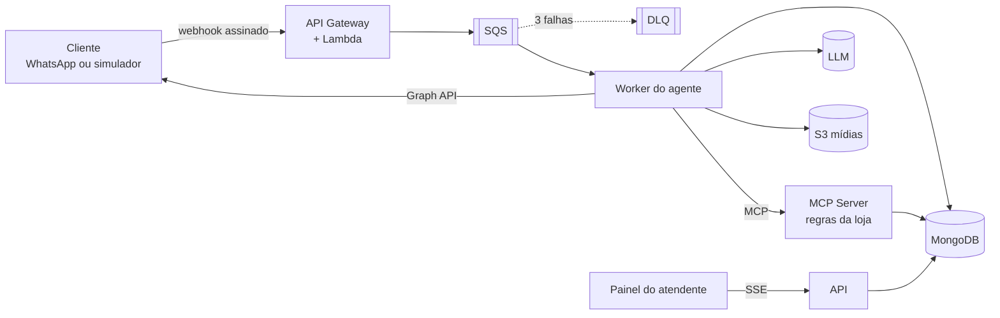

# ZapAgent


Atendimento no WhatsApp com agente de IA para uma loja online. O cliente pergunta do pedido, pede rastreio, agenda troca ou abre chamado. O agente resolve usando ferramentas expostas por um **servidor MCP** e, quando não deve ou não consegue resolver, **transfere para um atendente humano**, que assume a conversa num painel em tempo real.

O webhook da **WhatsApp Cloud API** roda como **AWS Lambda** atrás do API Gateway, valida a assinatura da Meta e enfileira no **SQS**. Um worker consome a fila com idempotência, conversa com o LLM, guarda a memória no **MongoDB** e as mídias no **S3**.

Tudo roda localmente sem conta da Meta e sem conta da AWS: há um simulador de WhatsApp e a AWS é emulada pelo LocalStack.

Exemplo ilustrativo do fluxo:

```
Cliente: "Quero trocar a jaqueta do pedido 1002, veio no tamanho errado. Pode coletar dia 14?"

  agendar_troca(numero_pedido=1002, motivo="tamanho errado", data_coleta=...)   ← telefone injetado pelo servidor
  → {"protocolo": "TR-20260312-4F1A", "data_coleta": "..."}

Aurora: "Pronto! Sua troca foi agendada para o dia 14. Protocolo TR-20260312-4F1A."
```

## Arquitetura em uma imagem



Detalhes em [docs/02-arquitetura.md](docs/02-arquitetura.md).

## Destaques técnicos

- **Webhook serverless:** a Lambda só valida a assinatura `X-Hub-Signature-256` (HMAC em tempo constante) e enfileira. Ela responde em milissegundos, sem dependências além da stdlib e do boto3.
- **Entrega confiável:** SQS com long polling, backoff na visibilidade e DLQ após 3 tentativas.
- **Idempotência:** claim atômico por `message id` do WhatsApp com índice único, então reenvios da Meta não geram resposta duplicada.
- **Identidade injetada:** o telefone do cliente é removido do schema que o modelo vê e injetado em toda chamada de ferramenta, então nem um prompt injection acessa pedido de outra pessoa.
- **Handoff humano como estado:** os estados `bot`, `waiting_human` e `human` ficam na entidade. O bot fica em silêncio enquanto o atendente atende e há quatro gatilhos de transferência, inclusive falha do LLM.
- **Degradação elegante:** com o LLM ou o MCP fora do ar, o cliente recebe uma mensagem de contingência e cai na fila humana.
- **Tempo real:** change streams do MongoDB → Server-Sent Events → painel.
- **Infra como código:** bootstrap idempotente no LocalStack e Terraform (HTTP API, Lambda, SQS + DLQ, S3 privado, IAM mínimo) para a AWS real, com deploy via OIDC.
- **Evals:** conversas roteirizadas medem ferramenta certa, transferência certa e vazamento de dados.

## Como rodar

Pré-requisito: Docker com Compose v2.

```bash
cp .env.example .env
docker compose up -d --build
```

Acesse **http://localhost:8480**. À esquerda fica o celular simulado; à direita, o painel do atendente.

> Na primeira execução, o LocalStack baixa a imagem de runtime da Lambda, e o `bootstrap` pode levar alguns minutos.

Sem LLM configurado, o fluxo funciona de ponta a ponta: o agente falha de forma controlada, o cliente recebe a mensagem de contingência e a conversa vai para a fila humana. Para respostas reais do agente:

- **Ollama local (sem custo):** `docker compose --profile local-llm up -d --build` e depois `docker compose --profile local-llm run --rm ollama-pull`.
- **OpenAI:** no `.env`, defina `LLM_BASE_URL=https://api.openai.com/v1`, `LLM_API_KEY=sk-...` e `LLM_MODEL=gpt-4o-mini`, e rode `docker compose up -d`.
- **Modelos de raciocínio** (família `gpt-5`, `o3`, `o4`): deixe `LLM_TEMPERATURE` vazio. Como o agente usa ferramentas, alguns desses modelos exigem `LLM_REASONING_EFFORT=none` no endpoint de chat (testado com `gpt-5.6-luna`).

### Roteiro de demonstração

| Contato | Mensagem | O que acontece |
|---|---|---|
| Ana | "Qual o status do pedido 1001?" | `consultar_pedido` |
| Ana | "Me passa o rastreio do 1001" | `rastrear_entrega` |
| Ana | "Quero trocar a jaqueta do 1002, tamanho errado, coleta em AAAA-MM-DD" | `agendar_troca` com protocolo |
| Bruno | "Quero trocar a mochila do pedido 1003" | A loja recusa: fora do prazo de 30 dias |
| Carla | "Qual o status do pedido 1001?" | Pedido de outra cliente: não é exposto |
| Qualquer um | "Quero falar com um atendente" | Vai para a fila sem chamar o LLM |
| Qualquer um | Imagem pelo 📎 | Mídia salva no S3 e citada no painel |

### Portas

| Serviço | URL |
|---|---|
| Web (simulador + painel) | http://localhost:8480 |
| API (OpenAPI em `/docs`) | http://localhost:8400 |
| Servidor MCP | http://localhost:8481/mcp |
| LocalStack | http://localhost:8466 |

## Testes, smoke e evals

```bash
docker compose --profile test run --rm --build backend-test
docker compose --profile test run --rm --build --no-deps web-test
docker compose exec api python -m zapagent.entrypoints.smoke
docker compose --profile evals run --rm --build evals
```

O `backend-test` sobe MongoDB e LocalStack reais e testa o caminho API Gateway → Lambda → SQS, a rejeição de assinatura forjada, a verificação da Meta e a ida de uma mensagem envenenada para a DLQ.

## Usando o servidor MCP em outros clientes

Com a stack de pé, as ferramentas da loja ficam em `http://localhost:8481/mcp`. Teste com o MCP Inspector: rode `npx @modelcontextprotocol/inspector`, escolha o transporte *Streamable HTTP* e informe essa URL.

## Estrutura

```
zapagent/
├── backend/
│   ├── src/zapagent/
│   │   ├── webhook/          Lambda (stdlib + boto3)
│   │   ├── domain/           conversa, handoff, eventos
│   │   ├── application/      casos de uso e portas
│   │   ├── infrastructure/   MongoDB, Graph API, SQS, S3, OpenAI, cliente MCP
│   │   ├── store/            contexto da loja + servidor MCP
│   │   └── entrypoints/      worker, api, mcp, bootstrap, smoke
│   ├── tests/                unitários + integração
│   └── evals/                cenários de conversa
├── web/                      React + Vite (celular simulado + painel)
├── infra/terraform/          AWS real
├── docs/                     ideia, arquitetura, execução, pipeline e ADRs
└── docker-compose.yml
```

## Documentação

| Documento | Conteúdo |
|---|---|
| [01 - Ideia](docs/01-ideia.md) | Problema, objetivos, escopo e requisitos |
| [02 - Arquitetura](docs/02-arquitetura.md) | C4, sequência, máquina de estados, camadas e segurança |
| [03 - Execução](docs/03-execucao.md) | Como o projeto foi construído e os problemas encontrados |
| [04 - Pipeline](docs/04-pipeline.md) | CI/CD, configuração do GitHub e deploy na AWS |
| [ADRs](docs/adr) | Decisões de arquitetura |
