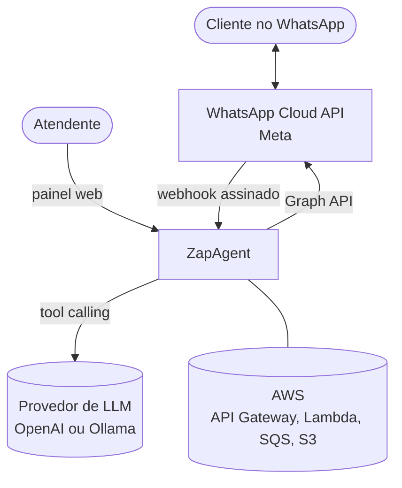
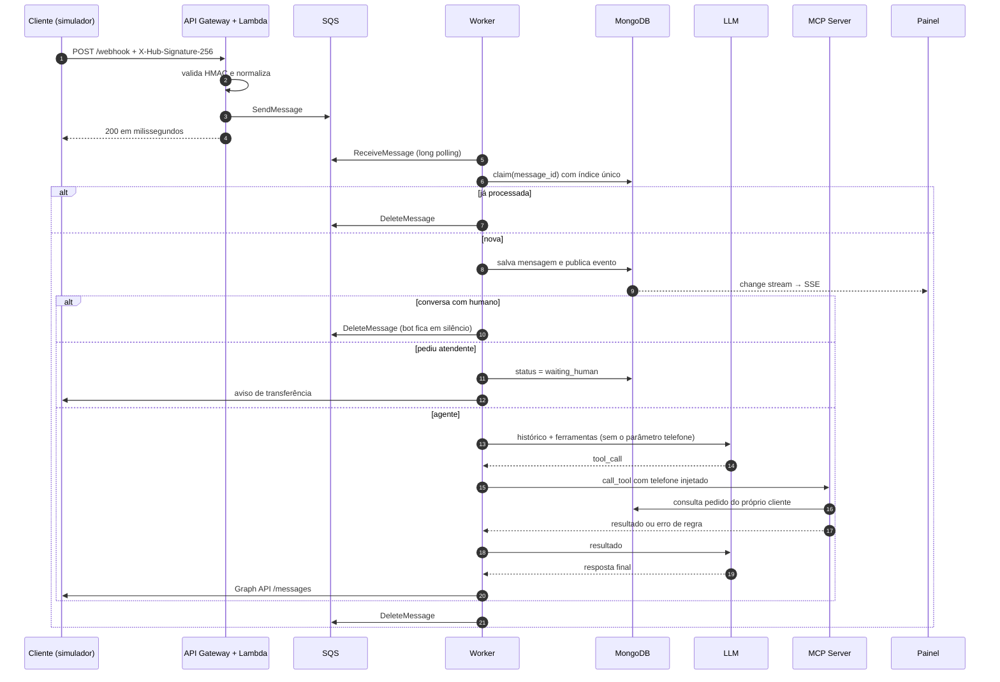
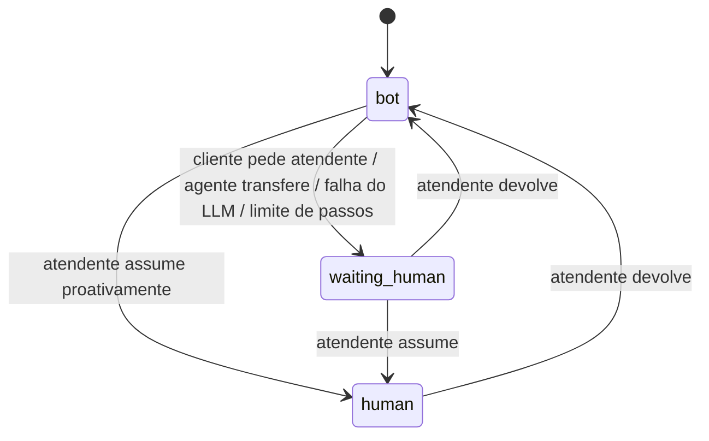
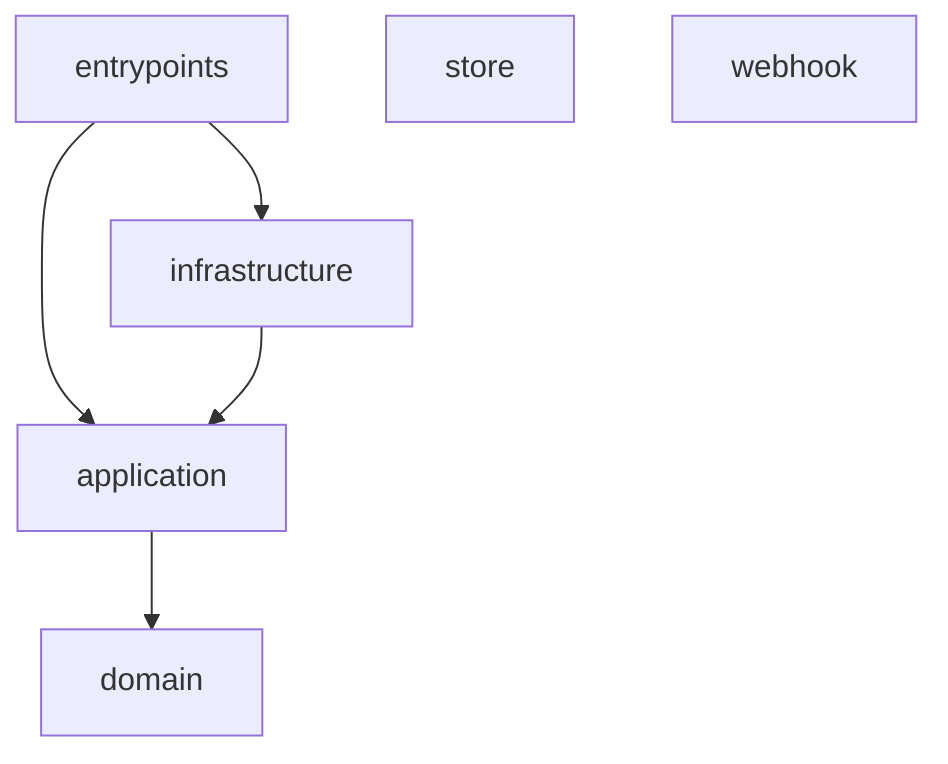

# 02 - Arquitetura

## Contexto (C4 nível 1)



## Containers (C4 nível 2)

```mermaid
flowchart LR
    subgraph Meta ou simulador
        graph[Graph API]
    end
    subgraph AWS ou LocalStack
        apigw[API Gateway<br/>/webhook]
        lambda[Lambda webhook<br/>stdlib + boto3]
        sqs[[SQS inbound]]
        dlq[[SQS DLQ]]
        s3[(S3 mídias)]
    end
    subgraph Containers
        worker[Worker do agente]
        mcp[MCP Server<br/>ferramentas da loja]
        api[API FastAPI<br/>painel, simulador, SSE]
        web[Web React<br/>celular + painel]
        mongo[(MongoDB<br/>replica set)]
    end
    llm[(LLM)]

    graph -- POST assinado --> apigw --> lambda --> sqs
    sqs -. 3 falhas .-> dlq
    sqs --> worker
    worker -- MCP streamable HTTP --> mcp
    worker --> llm
    worker -- mensagens --> graph
    worker -- mídia --> s3
    worker --> mongo
    mcp --> mongo
    api --> mongo
    web -- REST + SSE --> api
```

| Container | Responsabilidade | Não faz |
|---|---|---|
| **Lambda webhook** | Responde à verificação da Meta, valida a assinatura HMAC, normaliza e enfileira | Não chama LLM, não acessa banco; só usa stdlib + boto3 |
| **worker** | Consome a fila, garante idempotência, baixa mídia, decide entre agente e humano, responde pela Graph API | Não conhece regras da loja |
| **mcp-server** | Regras de negócio da loja: dono do pedido, prazo de troca, protocolos | Não conhece conversa nem LLM |
| **api** | Painel do atendente, simulador de WhatsApp, Graph API falsa e stream de eventos | Não roda o agente |
| **web** | Celular simulado e painel em tempo real | — |

## Fluxo de uma mensagem



Se qualquer passo de infraestrutura falhar (MongoDB, Graph API, S3), o worker libera o claim e **não** apaga a mensagem. A visibilidade é estendida com backoff (5s × tentativa) e, depois de 3 recebimentos, o SQS move a mensagem para a DLQ.

Se o **LLM ou o MCP** falharem, a falha é tratada como negócio, não como infraestrutura: o cliente recebe uma mensagem de contingência, a conversa entra na fila humana e a mensagem é confirmada. Repetir a chamada a um LLM fora do ar só atrasaria a resposta.

## Máquina de estados da conversa



As transições ficam na entidade `Conversation` (domínio), e a regra "o bot não responde fora do estado `bot`" fica no caso de uso `ProcessInboundMessage`.

## Camadas

Um único pacote Python (`zapagent`) com contextos separados e vários executáveis:

```
src/zapagent/
├── webhook/          Lambda: só stdlib + boto3, empacotada sozinha
├── domain/           Conversation, ChatEntry, Event, regras de handoff, tipos do LLM
├── application/      ProcessInboundMessage, RunAgent, AttendantDesk e as portas
├── infrastructure/   MongoDB, Graph API, SQS, S3, OpenAI, cliente MCP
├── store/            contexto da loja: StoreService, repositório e servidor MCP
└── entrypoints/      worker, api, mcp, bootstrap e smoke
```



- `application` depende só de portas (`LanguageModel`, `ToolGateway`, `MessageSender`, `MediaStorage`...). Nos testes, tudo isso é trocado por fakes em memória.
- `store` é outro *bounded context*: o worker só fala com ele via MCP, nunca importando o código.
- `webhook` não importa nada do resto do pacote, para a Lambda ficar com poucos KB e cold start mínimo.

## Segurança

| Ameaça | Controle |
|---|---|
| Alguém chama o webhook se passando pela Meta | HMAC-SHA256 do corpo com o *app secret*, comparado em tempo constante |
| Verificação do webhook por terceiros | `hub.verify_token` comparado em tempo constante |
| Prompt injection pedindo pedido de outra pessoa | O parâmetro `telefone` é removido do schema mostrado ao modelo e injetado pelo worker; o `StoreService` só devolve pedidos daquele telefone e usa a mesma mensagem para "não existe" e "não é seu" |
| Graph API falsa exposta | Exige o mesmo `Bearer` token que a Graph real |
| Mídias públicas | Bucket privado, criptografado e com expiração (Terraform) |

## Local × AWS

| Peça | Local (compose) | AWS (Terraform) |
|---|---|---|
| Webhook HTTP | API Gateway REST v1 no LocalStack | API Gateway HTTP API v2 |
| Lambda | LocalStack executa em container Python 3.12 | Lambda Python 3.12 |
| Fila | SQS LocalStack + DLQ | SQS + DLQ com criptografia gerenciada |
| Mídias | S3 LocalStack | S3 privado, SSE e lifecycle |
| WhatsApp | Graph API falsa dentro da API | Graph API da Meta |
| Worker, API, MCP | containers | imagens publicadas no GHCR, prontas para ECS |

A mesma Lambda aceita os dois formatos de evento (v1 e v2), e isso é coberto por teste.

## Decisões

| ADR | Decisão |
|---|---|
| [0001](adr/0001-webhook-serverless-com-fila.md) | Webhook em Lambda que só valida e enfileira |
| [0002](adr/0002-idempotencia-no-consumidor.md) | Idempotência no consumidor com claim no MongoDB |
| [0003](adr/0003-identidade-injetada-nas-ferramentas.md) | Telefone injetado nas ferramentas, invisível ao modelo |
| [0004](adr/0004-handoff-humano-como-estado.md) | Handoff humano como máquina de estados da conversa |
| [0005](adr/0005-simulador-e-localstack.md) | Simulador de WhatsApp e LocalStack para rodar sem contas externas |
