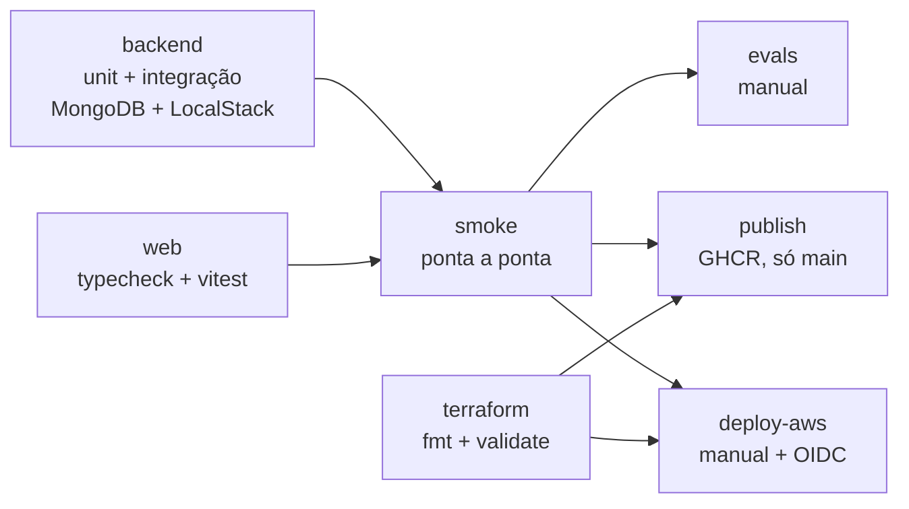

# 04 - Pipeline de CI/CD e deploy na AWS

Este guia explica a pipeline do projeto do zero: o que cada job faz, como configurar o GitHub e como publicar a parte serverless na AWS com Terraform.

Arquivos:
- [`.github/workflows/ci.yml`](../.github/workflows/ci.yml)
- [`infra/terraform/`](../infra/terraform)

## Conceitos em 1 minuto

| Termo | O que é |
|---|---|
| **Workflow** | Arquivo YAML em `.github/workflows/` que o GitHub executa quando um evento acontece |
| **Job** | Conjunto de passos numa máquina virtual limpa; jobs rodam em paralelo, a menos que um dependa de outro (`needs`) |
| **Secret** | Valor sensível (chave de API, app secret da Meta), mascarado nos logs |
| **Variable** | Configuração não sensível (região, modelo, ARN de role) |
| **Environment** | Ambiente nomeado (`production`) que pode exigir aprovação manual antes do job rodar |
| **OIDC** | O GitHub prova sua identidade para a AWS sem chave de acesso fixa; a AWS entrega credenciais temporárias |

## Princípio: o CI roda os mesmos comandos que você

Nenhum job instala Python, Node ou AWS CLI para testar. Tudo é `docker compose`, inclusive a "AWS" (LocalStack) e o "WhatsApp" (simulador). Se passa na sua máquina, passa no CI.

## Gatilhos

| Evento | Quando | O que roda |
|---|---|---|
| `pull_request` | PR aberto ou atualizado | backend, web, terraform, smoke |
| `push` na `main` | Após o merge | Tudo acima + publicação das imagens |
| `workflow_dispatch` | Botão **Run workflow** | Tudo acima + evals e/ou deploy, conforme as caixas marcadas |

## Fluxo dos jobs



### `backend`

```bash
docker compose --profile test run --rm --build backend-test
```

1. O compose sobe MongoDB (replica set) e LocalStack.
2. O container `bootstrap` cria bucket, filas com DLQ, empacota e publica a Lambda, cria o API Gateway e popula o MongoDB.
3. O `backend-test` roda ruff, checagem de formatação e pytest, incluindo os testes de integração:
   - webhook assinado atravessando API Gateway → Lambda → SQS;
   - assinatura forjada recusada com `401`;
   - verificação `hub.challenge` da Meta;
   - mensagem envenenada indo para a DLQ depois de 3 recebimentos;
   - repositórios e ferramentas MCP contra o MongoDB real.

O LocalStack precisa do socket do Docker (`/var/run/docker.sock`) para executar a Lambda. O runner `ubuntu-latest` já tem Docker, então funciona sem configuração extra.

### `web`

Typecheck com `tsc` e testes com Vitest, dentro do container Node.

### `terraform`

Roda `terraform fmt -check` e `terraform validate` no container oficial `hashicorp/terraform`. `init -backend=false` baixa os providers sem tocar em estado remoto, então o job não precisa de credenciais.

### `smoke`

Sobe a stack inteira (`up --wait`) e executa `python -m zapagent.entrypoints.smoke` dentro do container da API, que:

1. envia uma mensagem assinada pelo simulador;
2. espera o worker responder no celular simulado (no CI não há LLM, então a resposta é a mensagem de contingência e a conversa vai para a fila humana);
3. faz o atendente assumir e responder, e confirma que o bot **não** responde enquanto a conversa está com o humano;
4. devolve a conversa ao assistente;
5. envia uma imagem e confirma que ela foi salva no S3.

### `evals` (manual)

Roda as conversas de `backend/evals/scenarios.json` contra um LLM real e falha se a acurácia ficar abaixo de `EVALS_MIN_ACCURACY`. Cada cenário verifica:
- quais ferramentas foram chamadas;
- quais não podiam ser chamadas;
- se houve transferência;
- trechos obrigatórios ou proibidos na resposta.

### `publish` (só na `main`)

Publica `backend` e `web` no GitHub Container Registry com as tags `latest` e o SHA do commit.

### `deploy-aws` (manual)

Aplica o Terraform na AWS. Só roda se:
- você marcar **Aplicar o Terraform na AWS** no *Run workflow*;
- a variável `AWS_DEPLOY_ROLE_ARN` estiver configurada.

Sem isso, o job é pulado.

## Configurando o GitHub

### 1. Subir o repositório

```bash
git init
git add .
git commit -m "feat: estrutura inicial do ZapAgent"
git branch -M main
git remote add origin https://github.com/guilhermesilva97/zapagent.git
git push -u origin main
```

### 2. Permissões

**Settings → Actions → General → Workflow permissions**: *Read repository contents and packages permissions*. O `publish` pede `packages: write` e o `deploy-aws` pede `id-token: write` só para eles.

### 3. Evals (opcional)

**Settings → Secrets and variables → Actions**

| Tipo | Nome | Exemplo |
|---|---|---|
| Secret | `LLM_API_KEY` | `sk-...` |
| Variable | `LLM_BASE_URL` | `https://api.openai.com/v1` |
| Variable | `LLM_MODEL` | `gpt-4o-mini` |

### 4. Proteção da `main`

Exija os checks `Backend (...)`, `Front-end (...)`, `Terraform (...)` e `Smoke test ponta a ponta` antes do merge.

## Deploy na AWS, passo a passo

O Terraform cria:
- bucket S3 privado e criptografado, com expiração das mídias;
- fila `zapagent-inbound` com DLQ e criptografia gerenciada;
- Lambda do webhook (empacotada pelo próprio Terraform a partir de `backend/src/zapagent/webhook`);
- API Gateway HTTP API com `GET` e `POST /webhook`;
- logs com retenção de 14 dias;
- política IAM `zapagent-worker`, para anexar à role do worker quando ele for para ECS ou outro runtime.

### 1. Bucket para o estado do Terraform

Uma vez só, na sua conta:

```bash
aws s3api create-bucket --bucket <seu-bucket-de-estado> --region us-east-1
aws s3api put-bucket-versioning --bucket <seu-bucket-de-estado> --versioning-configuration Status=Enabled
```

### 2. Role para o GitHub via OIDC

1. No IAM, crie o *identity provider* `token.actions.githubusercontent.com` (audiência `sts.amazonaws.com`).
2. Crie uma role com a *trust policy* abaixo e permissões para Lambda, API Gateway, SQS, S3, IAM e CloudWatch Logs:

```json
{
  "Version": "2012-10-17",
  "Statement": [
    {
      "Effect": "Allow",
      "Principal": { "Federated": "arn:aws:iam::<conta>:oidc-provider/token.actions.githubusercontent.com" },
      "Action": "sts:AssumeRoleWithWebIdentity",
      "Condition": {
        "StringEquals": { "token.actions.githubusercontent.com:aud": "sts.amazonaws.com" },
        "StringLike": { "token.actions.githubusercontent.com:sub": "repo:guilhermesilva97/zapagent:environment:production" }
      }
    }
  ]
}
```

A condição `sub` limita a role a este repositório e ao environment `production`: nenhum outro repositório ou branch consegue assumi-la.

### 3. Configurar no GitHub

**Settings → Environments → New environment → `production`**. Opcionalmente, marque **Required reviewers** para exigir aprovação antes de cada deploy.

**Settings → Secrets and variables → Actions**

| Tipo | Nome | Valor |
|---|---|---|
| Variable | `AWS_DEPLOY_ROLE_ARN` | ARN da role do passo 2 |
| Variable | `AWS_REGION` | `us-east-1` |
| Variable | `TF_STATE_BUCKET` | bucket do passo 1 |
| Secret | `WHATSAPP_APP_SECRET` | *App secret* do app na Meta |
| Secret | `WHATSAPP_VERIFY_TOKEN` | Um texto aleatório que você escolhe |

### 4. Rodar o deploy

**Actions → CI → Run workflow →** marque **Aplicar o Terraform na AWS**. O job imprime as saídas, incluindo `webhook_url`.

### 5. Ligar o WhatsApp real

1. No painel do app na Meta, em **WhatsApp → Configuration → Webhook**, informe a `webhook_url` e o mesmo `WHATSAPP_VERIFY_TOKEN`. A Meta faz o `GET` de verificação, e a Lambda responde o `hub.challenge`.
2. Assine o campo `messages`.
3. No worker, configure:
   - `GRAPH_BASE_URL=https://graph.facebook.com`
   - `GRAPH_TOKEN=<token permanente do usuário do sistema>`
   - `PHONE_NUMBER_ID=<id do número>`
   - as URLs da fila e do bucket que o Terraform imprimiu, sem `AWS_ENDPOINT_URL`.

### Rodando o Terraform na sua máquina

Tudo via Docker:

```bash
docker run --rm -it -v "$(pwd):/repo" -w /repo/infra/terraform \
  -e AWS_ACCESS_KEY_ID -e AWS_SECRET_ACCESS_KEY -e AWS_SESSION_TOKEN \
  hashicorp/terraform:1.9 init -backend-config="bucket=<bucket>" -backend-config="key=zapagent/terraform.tfstate" -backend-config="region=us-east-1"
```

Troque `init ...` por `plan` ou `apply` nas execuções seguintes.

## Reproduzindo localmente

| Job | Comando |
|---|---|
| backend | `docker compose --profile test run --rm --build backend-test` |
| web | `docker compose --profile test run --rm --build --no-deps web-test` |
| terraform | `docker run --rm -v "$(pwd):/repo" -w /repo/infra/terraform hashicorp/terraform:1.9 fmt -check -recursive` |
| smoke | `docker compose up -d --build --wait` e depois `docker compose exec api python -m zapagent.entrypoints.smoke` |
| evals | `docker compose --profile evals run --rm --build evals` |
| limpar | `docker compose --profile test --profile evals down -v` |

Validar o workflow antes do push:

```bash
docker run --rm -v "$(pwd):/repo" -w /repo rhysd/actionlint:latest .github/workflows/ci.yml
```

## Problemas comuns

| Sintoma | Causa provável | Solução |
|---|---|---|
| `bootstrap` demora minutos na primeira vez | O LocalStack está baixando a imagem de runtime da Lambda | Normal só na primeira execução |
| Lambda fica `Pending` para sempre | O LocalStack não acessa o socket do Docker | Confira o volume `/var/run/docker.sock` no compose |
| Webhook responde `401` no simulador | `WHATSAPP_APP_SECRET` diferente entre API e Lambda | O bootstrap grava o segredo na Lambda; rode `docker compose up bootstrap` de novo |
| Painel sem tempo real | MongoDB sem replica set (change streams exigem) | O healthcheck do serviço `mongo` inicia o replica set; confira o log |
| `deploy-aws` não aparece | `AWS_DEPLOY_ROLE_ARN` vazio ou caixa não marcada | Revise o passo 3 do deploy |
| Containers `zapagent-localstack-1-lambda-*` sobram após o `down` | O LocalStack cria os containers da Lambda direto no Docker, fora do compose | `docker rm -f $(docker ps -aq --filter name=zapagent-localstack-1-lambda)` |
| Lambda responde `502` com `PermissionError` no log | O zip foi montado sem permissões de arquivo | Veja a etapa 6 do [03-execucao](03-execucao.md); o teste `test_lambda_package` protege contra isso |
